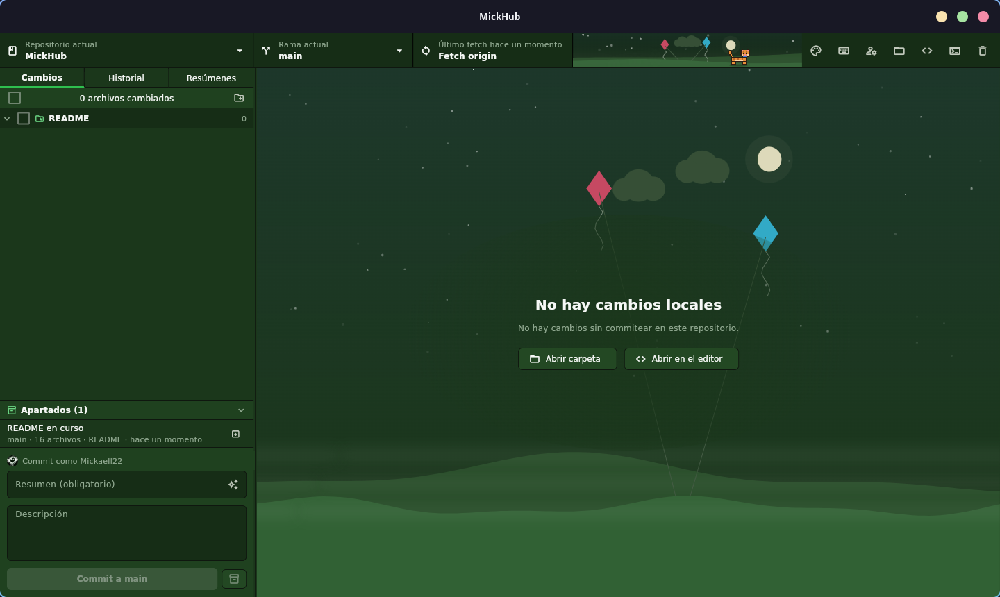
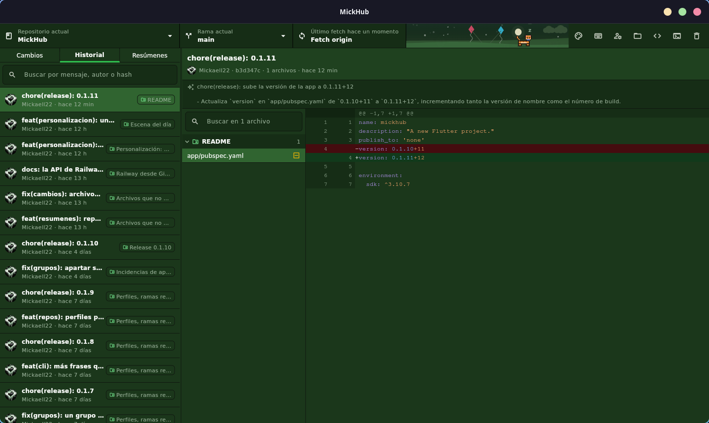
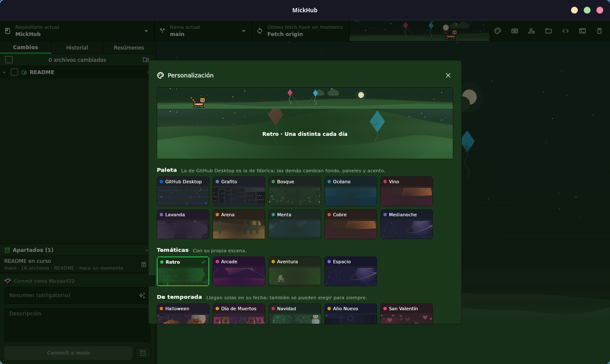
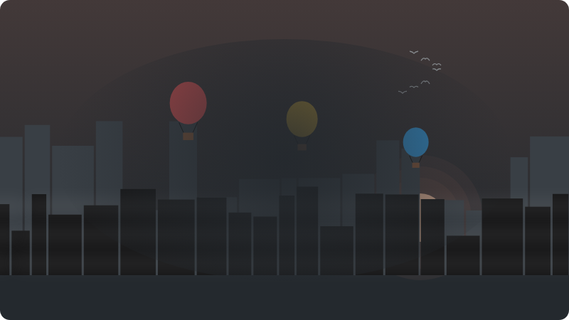
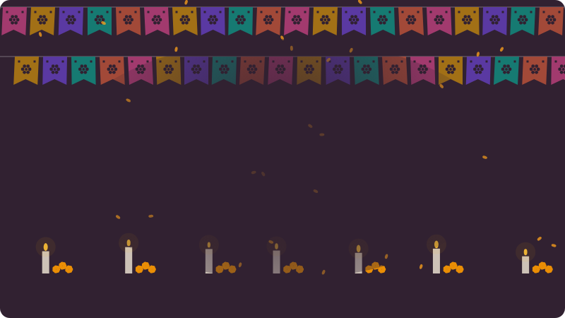
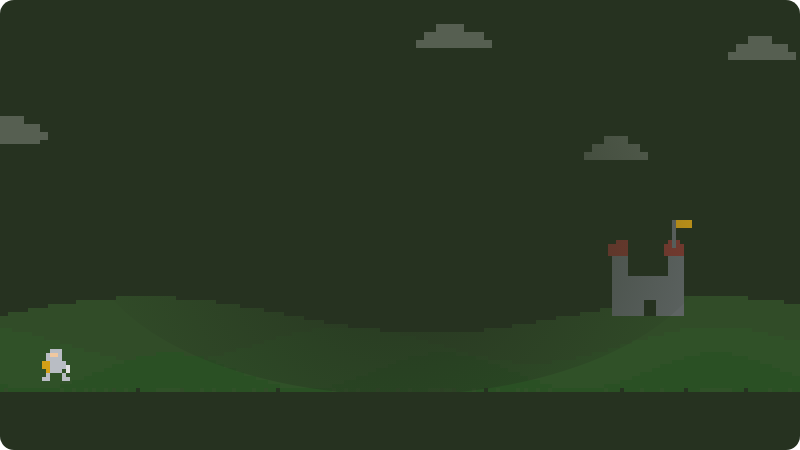
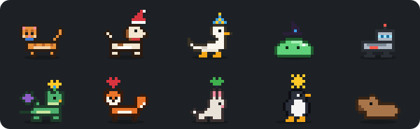
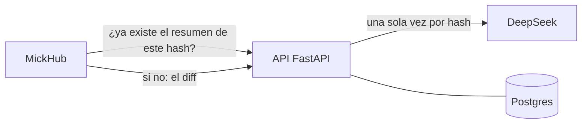

<div align="center">



<br/>


### Cliente de git de escritorio hecho a mi medida, para dejar GitHub Desktop.

**GitHub y Azure DevOps a la vez, cada repo con su cuenta**
<br/>
**Cambios locales que nunca se cuelan en un commit**
<br/>
**Resúmenes con IA de lo que hizo cada commit, y una escena distinta cada día del año**

<br/>

[](#descargar)
[](#qué-hace)
[](#resúmenes-con-ia)
[](#personalización)
[](#claude-code-por-mickhub)

<br/>

[](https://github.com/Mickaell22/mickhub/releases/latest)
[](./app)
[](./api)
[](LICENSE)

[**Descargar**](#descargar) • [**Qué hace**](#qué-hace) • [**Personalización**](#personalización) • [**Resúmenes con IA**](#resúmenes-con-ia) • [**Claude Code**](#claude-code-por-mickhub) • [**Atajos**](#atajos)

</div>

---

## Descargar

Ejecutables portables, sin instalador: se descomprimen y se abren.

| Sistema | Paquete | Cómo se abre |
|---|---|---|
| **Windows x64** | [mickhub-windows-x64.zip](https://github.com/Mickaell22/mickhub/releases/latest/download/mickhub-windows-x64.zip) | descomprimir y abrir `MickHub\MickHub.exe` |
| **Linux x64** | [mickhub-linux-x64.tar.gz](https://github.com/Mickaell22/mickhub/releases/latest/download/mickhub-linux-x64.tar.gz) | `tar -xzf mickhub-linux-x64.tar.gz` y abrir `MickHub/mickhub` |

Necesita `git` instalado; en Windows, con el Git Credential Manager (viene con Git for Windows). MickHub no guarda contraseñas: se las pide al gestor de credenciales de git. Cada release trae `SHA256SUMS.txt`, y la app avisa sola cuando hay una versión nueva y se actualiza en el lugar, después de verificar el SHA256.

## Qué hace

<table>
<tr>
<td width="50%" valign="top">

**Todos los repos, todas las cuentas**
<br/>
Una cuenta es una identidad (nombre y email con que firma) con su usuario de GitHub y sus organizaciones de Azure DevOps. Cada repo commitea, trae y sube con la suya, sin tocar la config de git. Perfiles por cuenta en la lista, carpeta de clonado por cuenta y clonar con un clic desde la lista de repos.

</td>
<td width="50%" valign="top">

**Cambios que nunca se suben**
<br/>
El candado protege un archivo (o un grupo entero) para que no aparezca nunca para commit: los cambios que solo sirven para correr el proyecto en local. Si un pull trae ese archivo, avisa en vez de fallar callado.

</td>
</tr>
<tr>
<td valign="top">

**Grupos de cambios y apartados**
<br/>
Los cambios se reparten por tarea, hasta por bloque dentro de un mismo archivo, y cada grupo se commitea, aparta, protege o descarta entero. Apartar y recuperar devuelve cada archivo a su grupo, sin romperse, con respaldo de cada apartado.

</td>
<td valign="top">

**Historial que se entiende**
<br/>
Búsqueda en todo el historial por mensaje, autor o hash; qué grupo trajo cada commit; "Continúa a… / Sigue en…" para los trabajos partidos en varios commits; y el resumen de la IA cuando el mensaje dice "ajustes".

</td>
</tr>
<tr>
<td valign="top">

**Pull sin miedo**
<br/>
Conflictos con "usar mi versión", "la del remoto" o abrir en el editor en la línea del conflicto; terminar o abortar merge y rebase. Si hay cambios sin commitear en los mismos archivos, los aparta, trae y vuelve a poner.

</td>
<td valign="top">

**Lo de todos los días, rápido**
<br/>
Atajos para todo, fetch en segundo plano, papelera para lo descartado, abrir el repo en el editor o la terminal, publicar repos nuevos en GitHub o Azure, y archivos en Latin-1 o con CRLF que se commitean byte por byte.

</td>
</tr>
</table>

<div align="center">

</div>

## Personalización

Ícono de paleta en la barra, o `Ctrl+,`. Todo lo que se ve está dibujado por la app (nada de imágenes descargadas ni personajes de terceros), se pausa con la ventana oculta y queda quieto si el sistema pide menos animaciones. Nunca tapa diffs, listas ni botones: vive en las pantallas vacías y en el hueco libre de la barra.

<div align="center">

</div>

- **24 paletas**: la de GitHub Desktop de fábrica, nueve clásicas, cuatro temáticas (Retro, Arcade, Aventura de 16 bits, Espacio) y las de temporada. Pueden cambiar solas cada día o al abrir.
- **Fechas especiales activas por defecto**: Halloween, Día de Muertos, Navidad, Año Nuevo, San Valentín, Carnaval, San Patricio, Día de la Tierra, Inti Raymi y tu cumpleaños.
- **Una escena distinta para cada día del año**: 366 combinaciones de terreno, lugar, hora y clima, sin repetir terreno dos días seguidos y con la luna en su fase real.
- **Mascotas en pixel art** que caminan por la barra, duermen de noche, festejan cuando commiteas y se ponen gorro en las fiestas.

<table>
<tr>
<td width="33%" align="center"><br/><sub>29 de mayo: faro en la costa bajo la luna, con nieve</sub></td>
<td width="33%" align="center"><br/><sub>12 de enero: noria en la ciudad bajo la luna, con pétalos</sub></td>
<td width="33%" align="center"><br/><sub>4 de enero: molino en las colinas bajo la luna, con lluvia</sub></td>
</tr>
<tr>
<td align="center"><br/><sub>13 de enero: pirámides en las dunas al atardecer, con niebla</sub></td>
<td align="center"><br/><sub>18 de enero: globos en la ciudad al amanecer, con niebla</sub></td>
<td align="center"><br/><sub>7 de enero: tren en la pradera bajo la luna</sub></td>
</tr>
<tr>
<td align="center"><br/><sub>Halloween</sub></td>
<td align="center"><br/><sub>Navidad</sub></td>
<td align="center"><br/><sub>Día de Muertos</sub></td>
</tr>
<tr>
<td align="center"><br/><sub>Arcade</sub></td>
<td align="center"><br/><sub>Aventura de 16 bits</sub></td>
<td align="center"><br/><sub>Espacio</sub></td>
</tr>
</table>

<div align="center">

<br/>
<sub>Gato, perro, pato, slime, robot, dragón, zorro, conejo, pingüino y capibara, con los gorros de las fiestas.</sub>
</div>

## Resúmenes con IA

Opcional. Al abrir un commit en el Historial, MickHub muestra qué hizo de verdad, escrito por DeepSeek a partir del diff. Corre en una API propia para que la key de DeepSeek no viaje a cada equipo.



- **Una vez por commit**: se guarda por hash, así el mismo commit que llega por varias ramas no se paga dos veces; los merges no gastan tokens.
- **Pestaña Resúmenes**: busca entre todo lo resumido, en el repo abierto o en todos; resume los últimos 50 commits de una vez y abre cualquiera en el Historial.
- **Reporte del período**: qué hiciste tú o el equipo hoy, ayer, esta semana, la pasada o en 30 días, en este repo o en todos los de la cuenta, con un apartado por persona; o lo que trae tu rama respecto de otra. Junta los resúmenes ya hechos, sin volver a leer diffs ni contar merges.
- **Mensaje del commit**: el botón con chispas del campo Resumen lo escribe a partir de lo marcado, con una pista opcional de qué hiciste y el estilo de los últimos mensajes del repo.

Para activarlo:

1. Correr `api/` con las variables de [`api/.env.example`](./api/.env.example): **en local** (API y Postgres en este equipo, solo en `127.0.0.1`) o **en la nube** (Railway: un servicio con la carpeta `api/` y un Postgres). [`docs/INSTALACION.md`](./docs/INSTALACION.md) es una guía paso a paso para que Claude Code la instale en cualquiera de los dos modos.
2. En el `settings.json` de MickHub, poner `apiUrl` (la URL de la API) y `apiToken` (el mismo `MICKHUB_API_TOKEN`). Vacíos, la pestaña no aparece.

## Claude Code por MickHub

Opcional. El comando `mickhub` (en `cli/`) le da a cada sesión de Claude Code su propio grupo de cambios: lo que edita cae solo en su grupo, aunque haya varias sesiones en el mismo repo o incluso en el mismo archivo, y `mickhub commit` commitea solo ese grupo con la cuenta del repo. La app muestra los grupos en vivo y abre la sesión de Claude de cada grupo con un clic derecho.

```sh
cd cli && dart pub get && dart compile exe bin/mickhub.dart -o ~/.local/bin/mickhub
```

Luego, en `~/.claude/settings.json`, un hook `PreToolUse` y otro `PostToolUse` con `"matcher": "Bash|Edit|Write|MultiEdit|NotebookEdit"` y `"command": "mickhub hook"`. Con eso, en los repos de MickHub, `git commit` y `git push` directos quedan bloqueados y Claude usa `mickhub commit` / `mickhub push`; el push solo pasa en el turno en que se lo pides. `mickhub --help` lista el resto: `estado`, `mover`, `apartados`, `apartar`, `recuperar`, `protegidos`, `proteger` y `desproteger`, para ver y arreglar desde la terminal lo mismo que en la app.

## Atajos

| Atajo | Qué hace | Atajo | Qué hace |
|---|---|---|---|
| `Ctrl+T` | repositorio | `Ctrl+Enter` | commit |
| `Ctrl+B` | rama | `Ctrl+Shift+P` | fetch / pull / push |
| `Ctrl+Shift+N` | nueva rama | `Ctrl+Shift+F` | abrir la carpeta |
| `Ctrl+1` `Ctrl+2` `Ctrl+3` | Cambios / Historial / Resúmenes | `Ctrl+Shift+A` | abrir en el editor, en el archivo elegido |
| `Ctrl+,` | personalización | `` Ctrl+` `` | abrir en la terminal |
| `F5` | refrescar | `Ctrl+/` | todos los atajos |

---

<div align="center">

En desarrollo y en uso diario: ya reemplaza a GitHub Desktop en el trabajo (Azure DevOps, Windows) y en casa (GitHub, Linux). Falta la vista de solo lectura para Android. Decisiones y detalles en [CLAUDE.md](./CLAUDE.md).

[MIT](LICENSE) · hecho por [Mickaell22](https://github.com/Mickaell22)

</div>
